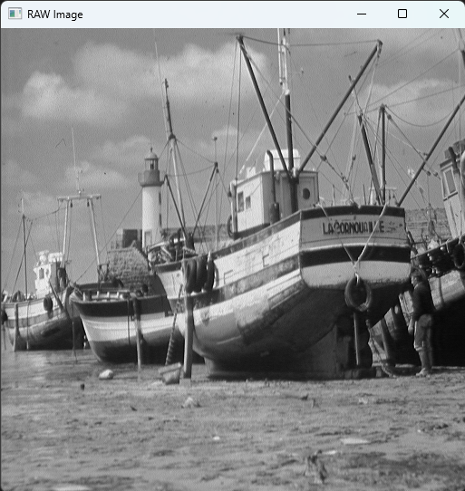

# 00. 개발환경 구축 (Visual Studio + OpenCV)

> 전공 교재를 참고해 설치 과정과 환경 설정을 정리했다.
>
> 참고 교재 : IOT에서의 디지털 영상처리 (김인겸 저)

**환경** : Visual Studio 2026 Community · OpenCV 4.14.0 · Debug / x64

## 1. Visual Studio 설치

Visual Studio Installer에서 **C++를 사용한 데스크톱 개발** 워크로드를 선택해 설치한다. 해당 워크로드에 MSVC 컴파일러와 링커, Windows SDK가 들어 있어서 컴파일러를 따로 설치할 필요가 없다.

## 2. OpenCV 설치

OpenCV 공식 사이트에서 Windows용 패키지를 받아 원하는 경로(예: `C:\opencv`)에 압축을 푼다. 미리 빌드된 파일이라 소스를 직접 컴파일하지 않아도 된다.

`build` 폴더에서 실제로 쓰는 곳은 크게 세가지이다. `include`에는 헤더 파일이, `x64\vcXX\lib`에는 링크할 때 필요한 lib 파일이, `x64\vcXX\bin`에는 실행할 때 필요한 dll 파일이 들어있다. `vcXX`는 OpenCV를 빌드한 Visual Studio 컴파일러 버전을 뜻한다.

lib는 모든 모듈이 `opencv_world4140.lib` 하나로 합쳐져 있고, 끝에 `d`가 붙은 `opencv_world4140d.lib`가 Debug용이다. Debug 빌드에 Release용 lib를 연결하면 빌드는 되더라도 실행 중에 비정상 종료될 수 있다.

## 3. 프로젝트 환경 설정

빈 C++ 프로젝트를 만들고 솔루션 플랫폼을 x64로 바꾼다. OpenCV 라이브러리가 x64용이라 x86으로 두면 링크 단계에서 실패한다. 이후 설정은 프로젝트 속성에서 Debug / x64 구성을 선택한 상태로 진행한다.

**C/C++ → 일반 → 추가 포함 디렉터리**에 `build\include`를 넣는다. 컴파일러가 `opencv2/opencv.hpp`를 찾는 경로라서, 빠지면 컴파일 단계에서 헤더를 찾지 못한다.

**링커 → 일반 → 추가 라이브러리 디렉터리**에는 `build\x64\vcXX\lib`를, **링커 → 입력 → 추가 종속성**에는 `opencv_world4140d.lib`를 넣는다. 헤더에는 함수 선언만 있고 실제 구현은 lib에 있기 때문에, 이 설정이 없으면 `cv::imshow` 같은 함수를 찾지 못해 링크 오류가 난다.

dll은 실행할 때 필요하다. Windows는 실행 파일과 같은 폴더나 환경 변수 `Path`에 등록된 폴더에서 dll을 찾으므로, `build\x64\vcXX\bin`을 `Path`에 추가하거나 **디버깅 → 환경**에 `PATH=...\bin;%PATH%`를 지정한다. 이게 없으면 빌드는 되는데 실행하자마자 dll이 없다는 창이 뜬다.

Release로 빌드할 때는 Release / x64 구성에도 같은 설정을 하고, 추가 종속성만 `d`가 없는 `opencv_world4140.lib`로 바꾼다.

## 4. 동작 확인

헤더 없는 8비트 그레이스케일 RAW 파일을 읽어 화면에 띄우는 [`main.cpp`](main.cpp)로 설정을 확인했다.

테스트 이미지는 경로에 공백·한글이 없도록 `C:\dev\DIP_Image`에 두고, 프로젝트 속성의 **디버깅** 항목을 다음과 같이 설정했다.

| 항목 | 값 |
|---|---|
| 명령 인수 | `boat.512 512 512` (파일, 가로, 세로) |
| 작업 디렉터리 | `C:\dev\DIP_Image` |
| 환경 | `PATH=C:\opencv\build\x64\vc16\bin;%PATH%` |

### 정상 실행

### 잘못된 입력 처리

| 명령 인수 | 출력 |
|---|---|
| `boat.512 256 256` | `[error] size mismatch: file is 262144 bytes, expected 65536 (256 x 256)` |
| `없는파일.512 512 512` | `[error] cannot open file: 없는파일.512` |
| `boat.512 -512 512` | `[error] WIDTH must be positive: -512` |

## 막힌 점

### 명령 인수를 바꿔도 이전 이미지만 출력됨
- 원인: 명령 인수는 구성(Debug / Release)마다 따로 저장된다. Release 구성에서 인수를 수정했지만 실행은 Debug로 하고 있었다.
- 해결: 속성 창의 구성을 **모든 구성**으로 바꾼 뒤 명령 인수를 입력했다.

### 작업 디렉터리를 바꾸자 `opencv_world4140d.dll이 없어` 오류 발생
- 원인: Windows는 dll을 찾을 때 현재 작업 디렉터리도 검색한다. 그동안은 프로젝트 폴더를 통해 dll을 찾고 있었는데, 작업 디렉터리를 이미지 폴더로 바꾸면서 찾지 못하게 됐다.
- 해결: **디버깅 → 환경**에 OpenCV `bin` 경로를 `PATH`로 직접 지정해, 작업 디렉터리와 상관없이 dll을 찾도록 했다.
